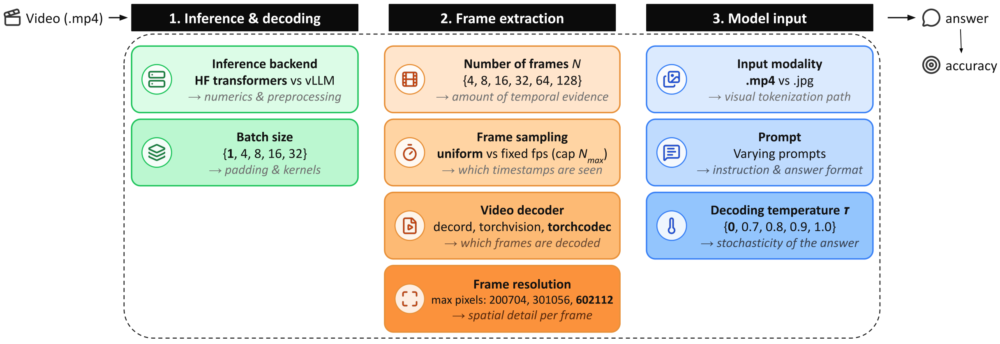

<div align="center">
<br>
<h2>Meta-Video: Efficient Standardized Evaluation for Video Understanding</h2>
<h3>Under review</h3>

Soumya Shamarao Jahagirdar<sup>1</sup>&emsp;
Anna Kukleva<sup>2</sup>&emsp;
Vishaal Udandarao<sup>1</sup>&emsp;
Samuel Thomas<sup>3</sup>&emsp;
Brian Kingsbury<sup>3</sup>&emsp;
Rogerio Feris<sup>3,5</sup>&emsp;
James R. Glass<sup>4</sup>&emsp;
Ameya Prabhu<sup>6</sup>&emsp;
<a href="https://hildekuehne.github.io/">Hilde Kuehne</a><sup>1,5,6</sup><br>
<sup>1</sup>University of Tübingen&emsp;<sup>2</sup>Max Planck Institute for Informatics, SIC&emsp;<sup>3</sup>IBM Research&emsp;<sup>4</sup>MIT&emsp;<sup>5</sup>MIT-IBM Watson AI Lab&emsp;<sup>6</sup>Tübingen AI Center<br><br>

<a href='https://soumyasj.github.io/meta-video/'></a> &emsp;
<a href='./Meta-Video.pdf'></a> &emsp;
<a href='https://huggingface.co/datasets/soumyasj/Meta-Video'></a> &emsp;
<a href='https://huggingface.co/datasets/soumyasj/video-benchmarks-nonblind'></a>

<p align="center">
  
</p>
</div>

---

`lmms_eval_video` is a fork of [lmms-eval](https://github.com/EvolvingLMMs-Lab/lmms-eval) for **video benchmarks**.
The same model checkpoint scores differently depending on how many frames it gets, which library decoded them,
how large they are, whether the backend sends a video or a list of images, and how the answer is decoded. Papers
rarely report these choices. This repository makes them explicit:

- **One YAML file per evaluation.** Every setting that changes what the model sees or how it answers lives in a single
  config; the runner refuses settings a model wrapper would silently ignore, and writes an **evaluation card** next to
  every result with the resolved configuration and the exact command.
- **Meta-Video (`metav`)**, a 1,000-question benchmark drawn from five video suites, filtered for questions that need the
  video and selected to preserve model rankings at about 5x less compute than the full suites.
- **Reference documentation** for what actually runs: [DATASETS.md](./DATASETS.md) (every video task: dataset version,
  splits, prompt, metric, judge) and [MODELS.md](./MODELS.md) (every model family: arguments, how frames become tokens,
  backends, known issues).

## Installation

```bash
git clone https://github.com/soumyasj/lmms_eval_video
cd lmms_eval_video
pip install -e .              # or: uv pip install -e .
pip install -r eval_scripts/env/requirements-lock.txt   # the exact versions the paper's numbers were produced with
```

Two environments cover all model families (see [MODELS.md](./MODELS.md#environments)): transformers 4.57 / vLLM 0.11
for Qwen2.5-VL, Qwen3-VL and Gemma 3; transformers 5.16 / vLLM 0.28 for Qwen3.5, InternVL3.5 and GLM-V. Batch-invariant
vLLM runs need vLLM >= 0.11.1. Set `HF_HOME` to the cache that holds (or should receive) the benchmark videos, and `HF_TOKEN`
for gated datasets.

## Quickstart

```bash
# Meta-Video, Qwen2.5-VL-7B, 32 frames, HF backend: the first run downloads the dataset (questions + 70 GB of videos)
python eval_scripts/run_eval.py configs/example.yaml

# see what would run (resolved settings, evaluation card, the final `python -m lmms_eval` command), run nothing
python eval_scripts/run_eval.py configs/example.yaml --dry_run

# override single keys without editing the file
python eval_scripts/run_eval.py configs/example.yaml --set model=qwen3vl_8b --set nframes=64 --set limit=20
```

Results land in `logs/runs/<config name>/<task>/<model>/<run tag>/` with lmms_eval's `*_results.json` and per-sample
logs, plus `config.json` and `evaluation_card.md`. `python eval_scripts/collect_results.py` tabulates every finished run.

---

## 1. Standardized evaluation

### 1.1 The configuration file

[`configs/example.yaml`](./configs/example.yaml) lists every key with its default. Four keys are **toggles** and may be
lists; the script runs the full grid. Everything else is fixed for the grid.

| group | key | values | what it changes |
|---|---|---|---|
| toggle | `tasks` | any video task or group ([DATASETS.md](./DATASETS.md)) | the dataset |
| toggle | `model` | HF id or alias ([MODELS.md](./MODELS.md)) | the checkpoint and, through it, the runner family |
| toggle | `nframes` | int | frames per video (uniform sampling), or the cap in fps mode |
| toggle | `backend` | `hf` \| `vllm` \| `hf_tiled` | transformers `generate`, the vLLM engine, or InternVL's image tiler per frame |
| toggle | `vllm_fix` | bool | on `vllm`: forward the `.mp4` to vLLM (one video, temporal merge, timestamps) instead of N separate images; Qwen2.5-VL only |
| input | `input` | `video` \| `frames` | the `.mp4` (the wrapper samples frames) or pre-extracted JPEGs (`<task>_frames<N>`, see 1.5) |
| input | `frame_sampling`, `fps`, `max_frames` | `uniform` \| `fps` | exactly `nframes` frames, or `fps` frames per second capped at `max_frames` |
| input | `frame_sampler` | `uniform` \| `random` | which positions out of the decoded frames (Qwen2.5-VL hf only, seeded) |
| input | `video_reader` | `decord` \| `torchvision` \| `torchcodec` | the decoding library; they do not return identical frames |
| input | `max_pixels`, `min_pixels` | int | per-frame pixel budget (tokens per frame = pixels / patch area); default per family |
| input | `max_patches`, `min_patches` | int | InternVL: 448x448 tiles per frame |
| runtime | `batch_size`, `batch_invariant` | int, bool | batch size; `VLLM_BATCH_INVARIANT=1` so vLLM answers do not depend on the batch |
| runtime | `num_gpus`, `tensor_parallel_size`, `gpu_memory_utilization`, `max_model_len`, `max_num_seqs` | | data parallel replicas; vLLM engine settings |
| runtime | `env`, `attn` | path, str | environment `bin` dir to run in; attention implementation (hf) |
| decoding | `temperature`, `max_new_tokens` | | `null` = the task yaml's `generation_kwargs` (temperature 0, 16 tokens for most MCQ tasks) |
| decoding | `enable_thinking` | bool | Qwen3.5 / thinking checkpoints: emit the answer directly (default) or a reasoning trace first |
| decoding | `seed` | int | lmms_eval seed, also the frame-sampler seed |
| decoding | `prompt` | `{variant, post_prompt, option_style, layout}` | Meta-Video only: prompt variant per model family, a replacement answer instruction, option label style, text/visual order |
| bookkeeping | `name`, `output_root`, `resume`, `limit`, `include_path`, `extra_model_args` | | run-set name, where results go, skip finished runs, smoke tests |

What the script does with it, for every point of the grid:

1. resolves the alias to an HF id and the id to a **runner family** (`qwen25vl`, `qwen3vl`, `qwen35`, `internvl`, `glm`, `gemma`);
2. checks that the family's wrapper can honour every setting and **refuses** otherwise. Examples: fps sampling on vLLM
   (vLLM samples a frame count), a random frame sampler on Qwen3-VL (its wrapper has none), `max_patches` on InternVL's
   stock video path (ignored there), a raw `.mp4` for Gemma 3 (its wrapper applies no frame budget). A run never silently
   uses an uncontrolled setting;
3. calls the family's runner in `eval_scripts/runners/`, which builds the `--model_args` string and the
   `python -m lmms_eval` command ([MODELS.md](./MODELS.md) lists them per family and backend);
4. writes `evaluation_card.md`: model, task, backend, batch, frames and how they were sampled, decoder, resolution,
   tokens per frame, decoding settings, prompt, seed, environment, command. Put it next to any number you report.

### 1.2 The reference protocol

The defaults in `configs/example.yaml` are the protocol every number in the paper uses:

| setting | value | why |
|---|---|---|
| backend | HF transformers | the reference path; stock vLLM sends N images instead of a video (1.3) |
| input | `.mp4`, uniform sampling, exactly `nframes` frames | 1 fps sampling costs 3 to 5 points on short-clip benchmarks |
| decoder | torchcodec | decoders disagree on which frames they return; torchvision drops MVBench by 10 points |
| resolution | family default (`max_pixels` 602112 for Qwen2.5-VL, 524288 Qwen3-VL, 131072 Qwen3.5; 1 tile for InternVL) | under 1 point of effect, but it sets the token count |
| batch size | 1 (or any, on hf) | score-neutral within a backend on hf; vLLM needs `batch_invariant` |
| decoding | temperature 0, the task's token cap, thinking off | temperature 1 costs 5 points on Video-MME |
| seed | 22 | |

[`configs/metav_protocol.yaml`](./configs/metav_protocol.yaml) reproduces the paper's standardized comparison (five
models, 4 to 128 frames, Meta-Video); [`configs/source_benchmarks.yaml`](./configs/source_benchmarks.yaml) runs one model
on the seven source benchmarks; [`configs/backend_comparison.yaml`](./configs/backend_comparison.yaml) compares HF, stock
vLLM and the vLLM video fix.

### 1.3 Backends: what the model actually receives

- **`hf`**: lmms_eval's transformers wrapper of the family. The `.mp4` goes through the model's own video processor:
  Qwen2.5-VL / Qwen3-VL merge frame pairs and (Qwen3-VL) write `<t seconds>` timestamps into the prompt; InternVL
  resizes every frame to one 448x448 tile; see [MODELS.md](./MODELS.md).
- **`vllm`**: lmms_eval's generic vLLM wrapper decodes the video **client-side** and sends the frames as N separate
  images. Qwen2.5-VL then sees N x `<|image_pad|>`: no temporal merge, no video position ids, no timestamps. HF and
  stock vLLM differ by 4 to 6 points on TempCompass, MVBench and Meta-Video because of this.
- **`vllm` + `vllm_fix: true`**: the out-of-tree plugin `eval_scripts/runners/vllm_fix/` hands vLLM a `file://` URL,
  so vLLM decodes the video server-side through the model's own processor and builds the same single `<|video_pad|>`
  block as the hf path. Qwen2.5-VL only. `batch_invariant: true` makes vLLM answers independent of the batch (vLLM >= 0.11.1).
- **`hf_tiled`** (InternVL): the model card's `load_video(max_num=M)` recipe, every frame through the image tiler, so
  `max_patches` tiles per frame actually apply.

### 1.4 Reproducing the paper's sweeps

The one-knob-at-a-time sweeps behind the paper's tables are scripts over the same runners and resume automatically:

```bash
bash eval_scripts/sweep_params.sh --model qwen25vl_7b --task videomme     # exp1..exp8: backend, batch size, decoder, frame positions, fps vs uniform, frames, pixels, .mp4 vs frames, temperature
bash eval_scripts/sweep_frames.sh --model qwen3vl_8b                      # accuracy vs 4..128 frames, .mp4 and pre-extracted frames, every task in TASKS
bash eval_scripts/sweep_vllm_fix.sh --model Qwen/Qwen2.5-VL-7B-Instruct --task metav   # hf vs stock vLLM vs vllm_fix over batch sizes and seeds
python eval_scripts/collect_results.py --csv runs.csv                     # one table per sweep / task / model / experiment
```

Each script's header documents its grid and environment knobs.

### 1.5 Pre-extracted frames

```bash
python eval_scripts/make_frames_task.py --task videomme     # hours for long benchmarks; --workers N
python eval_scripts/make_frames_task.py --task metav
```

Extracts 128 uniform frames per video into `data/frames/videos/`, writes `data/frames/<task>_frames<N>.parquet` for
N = 4 ... 128 and registers the tasks `<task>_frames<N>` (same prompt and metric as the source task, JPEG frames instead
of the video). `input: frames` in a config selects them. This is the only video input GLM-V and Gemma 3 accept on hf.

### 1.6 What this fork changes in lmms_eval

Every change is listed with its cause in [MODELS.md](./MODELS.md#what-this-fork-changes) and
[DATASETS.md](./DATASETS.md#task-level-changes). The short version:

- the torchvision decoder decoded whole clips into memory (100 to 250 GB on Video-MME) and is now seek-based;
- `nframes` larger than a clip crashed the Qwen wrappers and is now clamped;
- fps sampling ignored the frame cap, so hour-long videos expanded without bound;
- InternVL's video processor crashed on every sample and the run scored ~0 % instead of failing;
- result files are named after the run configuration; dataset caches are not re-resolved on every run;
- a seeded random frame sampler, the pre-extracted-frames task generator, the `vllm_fix` plugin and the `metav` task.

---

## 2. Meta-Video (`metav`)

Five video benchmarks recombined into one evaluation set of **1,000 questions on 791 videos** (none longer than 60
minutes, at most 3 questions per video). The data is the Hugging Face dataset
[`soumyasj/Meta-Video`](https://huggingface.co/datasets/soumyasj/Meta-Video): config `meta_v` holds the questions, `videos/`
the 791 videos (70 GB). The first run downloads it to `$HF_HOME/meta_video`; nothing else is needed.

| source | full set | in `metav` | subtask |
|---|---|---|---|
| Video-MME | 2,700 | 312 | `metav_videomme` |
| LongVideoBench (val, video) | 1,337 | 240 | `metav_longvideobench_val_v` |
| LVBench | 1,549 | 146 | `metav_lvbench` |
| VideoMMMU (perception / comprehension / adaptation) | 300 / 300 / 300 | 60 / 60 / 60 | `metav_video_mmmu_{perception,comprehension,adaptation}` |
| VSI-Bench | 5,130 | 122 | `metav_vsibench` |

**How it was built.** Three models (Qwen2.5-VL-7B, Qwen3-VL-8B, InternVL3.5-8B) were run with black frames instead of
the video; every question that at least two of them still answered correctly was removed. From the remaining pool,
items were selected per source category so that the subset orders models the way the full benchmarks do (a newer family
beats the older one, a larger model beats a smaller one), with a cap of three questions per video. 937 questions are
multiple choice (564 with four options, 185 with five, 157 with ten) and 63 ask for a number; the correct letters are
balanced, so guessing scores 20.3. Videos: 335 short (< 5 min), 281 medium (5 to 20 min), 175 long (20 to 60 min).

**Scoring.** Each subtask maps the Meta-Video rows back onto its source task's document schema and re-uses the source's
parser and metric, so an item is scored exactly as in its benchmark (VSI-Bench numerical items use mean relative
accuracy). The Meta-Video score is the macro average over the five sources, VideoMMMU counting once as the mean of its
three tracks. Scores are lower than on the source benchmarks by construction, since the questions language priors solve
are gone: compare models by rank and by Meta-Video score, not against published numbers.

**Running it.**

```bash
python eval_scripts/run_eval.py configs/example.yaml                     # tasks: metav is the default
python eval_scripts/run_eval.py configs/metav_protocol.yaml              # the paper's five models x six frame budgets
python eval_scripts/score_metav.py --write logs/runs/*/metav/*/*/*/*_results.json   # macro score, written into the results file

# or plain lmms_eval, any wrapper
python -m lmms_eval --model qwen2_5_vl --model_args pretrained=Qwen/Qwen2.5-VL-7B-Instruct,max_num_frames=32 \
       --tasks metav --batch_size 1 --log_samples --output_path logs/metav_try
```

**Prompts.** The prompt text of every item is materialized once (`lmms_eval/tasks/metav/data/metav_prompts.json`), so
hf and vLLM runs of the same checkpoint see the same prompt (in lmms_eval, prompt blocks are otherwise keyed by the
registered model name). The `prompt:` keys of the config select a variant (`default`, `qwen3_vl`), replace the answer
instruction (`post_prompt`), restyle the option labels (`option_style`) or change the order of video and text
(`layout: vt | tvt | vtv`, frames input only).

**Files.** `lmms_eval/tasks/metav/`: one YAML per source, `utils.py` (schema mapping, response cleaning, the numeric
fallback for VSI-Bench), `data/` (items with selection metadata, ids per source, materialized prompts).
`METAV_VIDEO_ROOT=<dir>` points the task at another copy of the dataset repo.

**Non-blind splits.** The same black-frame filter applied to the full source benchmarks, plus MVBench, TempCompass,
MMVU and SciVideoBench, is released as
[`soumyasj/video-benchmarks-nonblind`](https://huggingface.co/datasets/soumyasj/video-benchmarks-nonblind): one config per
lmms_eval task, original columns, so a task can be pointed at it with `dataset_path` / `dataset_name` / `test_split: nonblind`.

---

## License

The code follows the lmms-eval license. The Meta-Video item lists and prompts are released under
[CC BY 4.0](http://creativecommons.org/licenses/by/4.0). The videos belong to the source benchmarks and keep their licenses.

## Citation

```bibtex
@misc{jahagirdar2026metavideo,
  title={Meta-Video: Efficient Standardized Evaluation for Video Understanding},
  author={Jahagirdar, Soumya Shamarao and Kukleva, Anna and Udandarao, Vishaal and Thomas, Samuel and Kingsbury, Brian and Feris, Rogerio and Glass, James R. and Prabhu, Ameya and Kuehne, Hilde},
  year={2026},
  note={Preprint}
}
```
